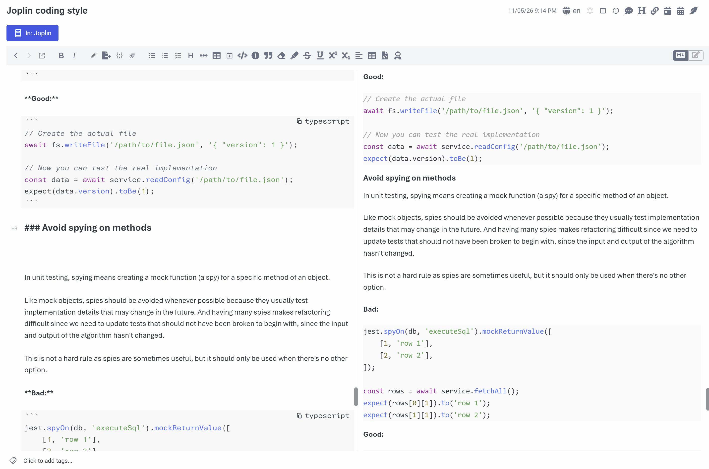

# Codeblock Utils

Codeblock Utils adds tools for fenced code blocks in Joplin:

- Language autocomplete and a command to insert, wrap, or unwrap code blocks in the Markdown editor.
- A copy button and optional title in the Markdown editor, Markdown viewer, and Rich Text Editor.
- Optional line numbers and per-block line highlighting.



> [!note]
> This plugin was created entirely with AI tools.

## Usage

### Create a code block

In the Markdown editor, type an opening fence of three or more backticks or tildes to open the language list. Selecting a language adds it and a matching closing fence. If the language has no matches, choose **Custom language** to use what you typed. For nested blocks, use more than three fence characters; the closing fence will have the same length.

If you disable language autocomplete, typing exactly three backticks or tildes immediately inserts a closing fence. The cursor stays at the end of the opening fence so you can type a language or press Enter.

You can also use the formatting toolbar button, Edit menu command, or keyboard shortcut (by default <kbd>CmdOrCtrl + Alt + `</kbd>). The command supports multiple cursors and selections. With no selection, it wraps the current line; inside an existing fenced block, it removes the surrounding fence lines.

### Copy and title a block

Enable the code block header for the Markdown editor or Markdown viewer to show a button that copies the block's code to the clipboard. The viewer setting also applies to the Rich Text editors. A block can show a title in its header with the [`title` option](#per-block-options).

| Where            | Header behavior                                                                                                                                                                                                                                     |
| ---------------- | --------------------------------------------------------------------------------------------------------------------------------------------------------------------------------------------------------------------------------------------------- |
| Markdown editor  | The language appears as a copy button at the top right, or **Copy** if no language is set. The title appears at the top left. The header replaces the opening fence while the cursor is elsewhere; click the title to reveal the fence for editing. |
| Markdown viewer  | An icon-only copy button appears on hover, stays visible on touch devices, and is keyboard accessible. The title appears above the code. Copying shows a success toast.                                                                             |
| Rich Text Editor | Uses the viewer setting. The mobile rich text editor hides the copy button because it has an **Edit** button in the same corner.                                                                                                                    |

The viewer header applies to rendered fenced code. It does not change indented or inline code, raw HTML code blocks, or fences Joplin renders as diagrams or other content (Mermaid, ABC notation, Fountain).

### Number and highlight lines

The Markdown editor and Markdown viewer have independent line-number settings; the viewer setting also applies to the Rich Text editors. Numbering starts at 1 for each fenced block. Use [per-block options](#per-block-options) to turn numbering on or off, change the starting number, or highlight chosen lines for specific code blocks. Highlighting works even when numbers are hidden.

Viewer line numbers preserve highlighting, are excluded when copying code, and do not apply to diagram blocks.

### Per-block options

Settings can be adjusted per code block by adding the following options after the language in the opening fence:

| Option            | Effect                                                                                                                       |
| ----------------- | ---------------------------------------------------------------------------------------------------------------------------- |
| `ln` or `ln=true` | Show line numbers for this block.                                                                                            |
| `ln=false`        | Hide line numbers for this block.                                                                                            |
| `start=N`         | Start at the whole number `N` (0 or greater) and show line numbers, unless `ln=false` is set.                                |
| `title="text"`    | Show a header title when the header is enabled. Quote titles containing spaces; use single quotes if the title contains `"`. |
| `hl=LINES`        | Highlight displayed line numbers, such as `hl=2,5-7`. With `start=10`, `hl=10` highlights the first line.                    |

For example:

````markdown
```python title="utils/greet.py" ln start=10 hl=11
def greet(name):
    return f"Hello, {name}"
```
````

The language must come first because Joplin uses the first word for syntax highlighting. To number a block without a language, use a placeholder such as `txt ln`. Options can appear in any order; unknown or invalid options are ignored. The editor's copy button shows only the language.

Other Markdown apps usually ignore the extra words and use the first one as the language. The Rich Text Editor preserves options when saving, copying, or editing a block; in the desktop editor's code block dialog, they appear in the Language field.

> [!warning]
> Adding options after `mermaid` or `abc` prevents those blocks from rendering as diagrams/abc notation in the Markdown viewer.

## Settings

| Setting                                                        | Controls                                                    |
| -------------------------------------------------------------- | ----------------------------------------------------------- |
| Enable language auto-complete                                  | Language dropdown for code fences.                          |
| Show Markdown editor code block header (title and copy button) | Header in the Markdown editor.                              |
| Show line numbers in Markdown editor code blocks               | Editor line numbers.                                        |
| Show Markdown viewer code block header (title and copy button) | Header in the Markdown viewer and Rich Text editors.        |
| Show line numbers in Markdown viewer code blocks               | Line numbers in the Markdown viewer and Rich Text editors.  |
| Autocomplete languages                                         | Comma-separated language identifiers shown in the dropdown. |
